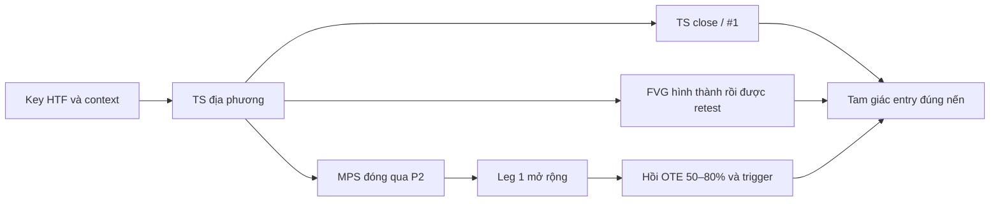

# Nghiên cứu entry bổ sung · 22/11/2026

## Ca XAUUSD của người dùng · 7 hình ngày 24/11/2026

**Kết luận nghiên cứu:** bản 54f7a88 đã áp MPS như một cổng chung trước mọi entry, không khớp ba nhánh người dùng đang dùng. Chuỗi cần theo dõi là **key HTF → CRT/TS địa phương → một trong các cách thực thi**, với MPS là điều kiện của nhánh hồi OTE. Cần sửa đặc tả trước khi nới ngưỡng hoặc tăng tần suất tam giác. Lần này chỉ nghiên cứu, chưa sửa Pine.

Nguồn ca là thư mục cục bộ Ví dụ, bảy ảnh XAUUSD/OANDA, trục giờ UTC+7: 1=H4, 2=H1, 3=M15, 4=M5, 5=H1 setup kế tiếp, 6=M15 cấu trúc setup kế tiếp, 7=M5 entry setup kế tiếp. Đã xem cả bảy ảnh. [Danh mục ảnh, hash, nguồn video và khoảng trống triển khai](research/crt-xauusd-user-example-2026-11-24.json) giữ nguồn có thể đối chiếu; ảnh gốc của người dùng không được đưa vào commit.

Một số hình đang ẩn TFA và header có HTF input=120 (H2). Vì vậy không dùng việc không thấy tam giác ngay trong các ảnh này làm kết quả kiểm thử runtime. Phải phân biệt khung đang xem, HTF engine được chọn và timeframe của key; H2.CRTH có thể là key của setup H1/M5 mà không buộc engine phát hiện một CRT H2 mới.

### Đọc hai setup trong chuỗi

| Nhóm ảnh | Sự kiện quan sát được | Vai trò đối với entry |
| --- | --- | --- |
| 1–3 | H4 có FVG/key và range; H1 có mức key và CRTH riêng. Giá quay lại vùng tham chiếu rồi phản ứng giảm. | Key/vị trí ở khung lớn cung cấp bối cảnh; không bắt mọi key phải là swing đã bị quét đúng như kind=3 hiện tại. Nguồn chính xác của line H1.Key level vẫn cần đặc tả. |
| 4 · setup sáng | Có nhịp lấy high, nến giảm trở lại range; sau đó giá đóng dưới low cấu trúc đánh dấu -MPS, chạy một nhịp xuống rồi hồi lên vùng OTE được đánh dấu. | Có ít nhất hai cách thực thi: TS close sớm và hồi sau MPS. Không cần một TS M5 mới sau MPS chỉ để hợp thức hóa entry OTE. |
| 5–6 | Hình thành vùng H1.FVG sau nhịp giảm; buổi chiều/tối giá hồi tới key đó, tạo chuỗi cấu trúc mới. | Đây là setup kế tiếp có ID/key/thời điểm riêng, không bị khóa vì một dấu Sell đã phát ở setup sáng. M15 giúp đọc cấu trúc, M5 dùng thực thi. |
| 7 · setup tối | P1 gần H2.CRTH, P2 là low của nhịp tăng, P3 là high TS tại vùng H1.FVG. Nhãn entry FVG nằm trước lúc giá phá low -MPS; nhãn entry OTE nằm sau khi low bị phá và nhịp giảm đầu đã kết thúc. | Nhánh TS→FVG được phép có trước MPS; nhánh MPS→OTE phải có MPS trước. Cùng một ý tưởng có nhiều ứng viên entry, không đồng nghĩa cộng thêm vị thế. |

Ở hình 4, **người dùng đã xác nhận nhãn #1 là tham chiếu; tam giác cần nằm trên chính nến TS đen sau nó**: high sweep và nến đóng giảm trở vào range CRT. Không đặt tam giác lên nến nguồn trước sweep, không đợi MPS cho nhánh này. Buy đối xứng: sweep low, nến đóng tăng trở vào range; tam giác dưới nến. Đây là quy tắc TS/#1 cá nhân đã chốt, chưa tự đồng nhất toàn bộ với Model 1 gốc của Romeo.

Mức giá trên ảnh chỉ đọc gần đúng: setup sáng có TS quanh 3678, low nhịp đầu quanh 3645–3647 và phản ứng hồi quanh 3660–3662; setup tối có TS quanh 3646–3647, low cấu trúc quanh 3622, đáy nhịp đầu quanh 3614–3616 và hồi quanh 3632. Không dùng các số ước lượng này để chấm tỷ lệ chính xác, ghim timestamp nến hoặc tạo OHLC giả cho backtest. Cần dữ liệu từng bar để kiểm tra chính xác mép 50%, thời điểm MPS/FVG được biết và thứ tự trong nến.

### Đối chiếu thêm lời giảng gốc

Đã truy cập trực tiếp giao diện Show transcript tiếng Anh tự động của hai video chính chủ, kiểm tra đúng channel ID. Đọc đầy đủ phần transcript OTE; với Model 1 đọc các đoạn kỹ thuật được dẫn dưới đây. Không dùng phần tóm tắt AI hoặc bình luận trên trang làm bằng chứng; chưa nghe/xem liên tục hai video. Hash transcript được lưu trong danh mục nguồn, bản chép đầy đủ chỉ lưu ở output cục bộ.

- **[CRTology ep.3: OTE, 02:16–03:42](https://www.youtube.com/watch?v=f4gdAohTi40&t=136):** sau close phá low cấu trúc mới bắt đầu tìm nhịp hồi; tác giả mô tả nhịp mở rộng rồi hồi, có bối cảnh key. Một giá trị fibo không tự tạo ra entry.
- **[08:12–09:45](https://www.youtube.com/watch?v=f4gdAohTi40&t=492)** và **[12:27–13:34](https://www.youtube.com/watch?v=f4gdAohTi40&t=747):** mô tả hồi xấp xỉ 50–80%; phần minh họa dùng vùng 0,5–0,79, kéo tới cuối leg 1 và có thêm ví dụ dùng body. Như vậy 50–80% của người dùng có cơ sở trong bài; quy ước triển khai ở đây vẫn dùng wick theo yêu cầu cá nhân, không tự đổi sang body.
- **[One CRT model for life, 10:06–10:56](https://www.youtube.com/watch?v=T7udbrWlARI&t=606)**, **[15:15–16:46](https://www.youtube.com/watch?v=T7udbrWlARI&t=915)** và **[19:13–22:19](https://www.youtube.com/watch?v=T7udbrWlARI&t=1153):** có mẫu thực thi từ một nến raid cụ thể và close xác nhận, phối hợp nhiều khung; FVG được nêu như yếu tố có thể đi kèm. Không có căn cứ từ các đoạn này để ép mọi mẫu sớm phải đợi MPS rồi tạo thêm một TS mới. Tiêu chí chọn nến và biên close của toàn bộ Model 1 gốc vẫn không được suy diễn từ một nhãn #1 trên ảnh.

Các mô tả của tác giả về xác suất/hoàn hảo không phải kết quả thống kê độc lập. Hai setup đi đúng hướng trong ảnh là ví dụ để chuẩn hóa workflow, không đo tỷ lệ thắng hay xác nhận mọi nhánh có lợi thế.

### Các điểm nghẽn cụ thể trong code hiện tại

| Vị trí | Đang làm gì | Hệ quả với ca này |
| --- | --- | --- |
| f_mpsKey / f_keyReact | Chỉ nhận kind=3: swing key biết trước C1, yêu cầu sweep/reclaim mức đó. | FVG H4/H1 và kiểu chạm/phản ứng vùng chưa được nhận diện. NO KEY có thể xuất hiện dù trader đã có key đúng loại đang sử dụng. |
| f_mpsSeed | Ép P1 bằng cực trị toàn C1 HTF, P3 bằng wick raid của model được chọn. | Có thể bỏ lỡ chuỗi P1/P2/P3 địa phương trên M15/M5 tại key. Cần lưu riêng range HTF, mức bị sweep và cấu trúc thực thi. |
| mainMpsAllowed / higherMpsAllowed / earlyMpsAllowed | Tất cả entry phải qua MPS. | Chặn trực tiếp TS close/#1 và entry FVG sớm trước MPS trong hình 7. |
| f_stepChannel | Sau cổng còn bắt một TS hai nến LTF mới, rồi retest trong Pullback. | OTE không tạo TS mới thì không có dấu, dù nhịp xác nhận/hồi đã có như hình 4/7. |
| f_stepR1 / f_mpsHandoff | Vùng nhập tay; extreme cố định bằng wick nến kích hoạt MPS. | Chưa tự theo dõi cuối leg 1 để tính OTE. Nhập vùng=0 vẫn WAIT_ZONE; không phải bộ nhận diện OTE tự động. |
| isLtf | Chỉ chạy thực thi M1/M3/M5; M15 không có vai trò cấu trúc độc lập. | Chưa có phân tầng key H4/H1 → cấu trúc M15 → entry M5 như ví dụ. Không nên bắt mọi khung đồng thời phát cùng một mẫu. |
| ctx.age==0 / localTargetTaken / targetAtBirth | Entry chỉ trong C3 của nguồn; cp cố định bằng đầu kia C1. | Cần tách tuổi context cha khỏi cửa sổ setup con, và target CRT gốc khỏi một cơ hội tiếp diễn mới. Không chỉ xóa các điều kiện hoàn thành để tăng dấu. |
| f_preferCrt / waveAllowed | Chọn một focus model cho mỗi engine, khóa nhịp theo hướng bằng pivot mới. | Chưa quản lý một chuỗi setup kế tiếp và nhiều nhánh entry theo ID/leg; có nguy cơ setup mới bị khóa bởi dấu của setup cũ. |

Đây là đối chiếu cấu trúc mã, chưa chạy replay đúng các bar XAUUSD trong ảnh. Chưa có OHLC, trạng thái bias D1 hoặc export WHY ở các bar đánh dấu để kết luận gate nào chặn đầu tiên trong từng lần chạy.

### Quy tắc hoàn thành và setup tiếp diễn

Trong hình 3/6, giá đã xuyên H4.CRTL ở nhịp thấp buổi chiều trước setup tối. Cần giữ đánh dấu hoàn thành của setup H4 cũ. Setup tối phải có key/range/TS/leg và mục tiêu mới hoặc bối cảnh mới được xác định rõ; không tái dùng setup H4 đã TP chỉ vì hướng vẫn Sell. Mức H4.CRTL đã bị lấy cũng không được ghi lại là thanh khoản chưa bị lấy.

Tương tự, low/high mục tiêu của CRT gốc có thể đã bị chạm trong leg 1 trước một ứng viên OTE. Muốn nghiên cứu tiếp diễn, phải tạo một giả thuyết thực thi mới với target/INV riêng; không vô hiệu hóa CP TAKEN của lệnh/setup trước. Cấu trúc dữ liệu nên là **context/ý tưởng → setup có ID riêng → leg → nhánh entry**. Context cũ có thể vẫn hữu ích để đọc thị trường dù quyền entry của nó đã kết thúc.

### Nhánh OTE cần được đặc tả lại

Theo yêu cầu người dùng, các đầu neo tính cả wick. Sell: S=high TS, L=low cuối leg 1 sau MPS, D=S−L; vùng hồi là **[L+0,50D; L+0,80D]**. Buy: S=low TS, H=high cuối leg 1, D=H−S; vùng hồi là **[H−0,80D; H−0,50D]**. Đây là phép tính nội bộ cho logic; không yêu cầu khôi phục công cụ fibo vẽ trên chart.

Endpoint phải được theo dõi trong quá trình leg 1 mở rộng, không chỉ lấy wick nến phá P2. Có thể cập nhật extreme theo từng nến đóng và tính vùng đã biết **trước** nến phản ứng. Khi dùng vùng để xác nhận entry, cố định hai neo và thời điểm được biết; không đổi low/high sau khi đã xem nhịp tiếp theo. Nếu một bar vừa tạo extreme mới vừa chạm vùng tính lại, OHLC không đủ xác định thứ tự; không tự coi đó là một lần hồi hợp lệ. Cách chốt kết thúc leg, touch/close-reaction và tình huống không hồi vẫn phải có quy tắc rõ trước mã hóa.

### Trình tự cải tổ đề xuất và ca nghiệm thu



1. Chuẩn hóa key với loại, timeframe, biên giá, formedAt/knownAt, trạng thái chạm/mitigation và vô hiệu. Ưu tiên các loại có trong mẫu: HTF FVG, mức CRTH/CRTL liên quan và line key cần giải thích nguồn. Phân biệt FVG HTF làm key với FVG LTF để thực thi. Yêu cầu mới có FVG/OTE là phạm vi cụ thể cho lần cải tổ tiếp theo; không tự khôi phục toàn bộ bộ lọc đã bỏ.
2. Tách TS close/#1 thành nhánh đầu tiên, không có cổng MPS bắt buộc. Emit ở chính bar sweep đã đóng trở lại range, theo xác nhận của người dùng. Range/reference phải được biết trước sweep; không dùng close cuối HTF tương lai cho entry LTF sớm.
3. Theo dõi MPS địa phương độc lập và endpoint leg 1 cho nhánh OTE. Bỏ yêu cầu có thêm một TS mới của nhánh này. Phân biệt M15 structure với M5 execution; chốt M15 là bắt buộc, hỗ trợ hay một lựa chọn thay thế trước khi mã hóa.
4. Thêm nhánh FVG retest sau TS. Vùng ba nến phải đã hình thành/được biết rồi mới xét bar retest tiếp theo; không đồng nhất bar tạo FVG với bar quay lại FVG. Chính sách fill/mitigation, invalidation và trigger cần chốt.
5. Ghi nguồn theo SetupId + Branch + Leg; gộp một tam giác khi nhiều nhánh cùng hướng/cùng bar, giữ mọi lý do trong tooltip. Setup mới có ID mới, không bị khóa chung vì đã có Sell trước đó. Quyền vẽ ứng viên entry không phải quyền tự thêm vị thế.
6. Chốt bốn ca dương mục tiêu: TS đen sau #1 ở hình 4; OTE sáng ở hình 4; FVG sớm trước MPS ở hình 7; OTE sau MPS ở hình 7. Ca đối chứng: chỉ râu/không reclaim, không có key hợp lệ, vùng chưa hình thành, chạm vùng trước khi biết, thiếu close nếu mode yêu cầu close, endpoint thay bởi dữ liệu tương lai, target/INV đã kết thúc setup cũ, setup mới độc lập sau TP, phản ứng không đủ 50%/vượt ngưỡng và cùng bar có thứ tự không xác định.

Các ca cần được chấm trên dữ liệu từng bar và kiểm tra mọi prefix/reload, không dựng giá tổng hợp rồi tuyên bố đã tái hiện ảnh. Triệu chứng ít dấu không đủ lý do tăng tần suất hay nới MPS tùy ý; thay đổi cần bám đúng ba nhánh đã phân biệt. Chưa thay code hoặc mặc định trong bước nghiên cứu này.

## Bổ sung 24/11/2026 · MPS theo video mới nhất

**Sau nghiên cứu, người dùng đã yêu cầu triển khai:** [cổng MPS trước entry](CRT-FIRST-LEG-SPEC.md#mps-trước-entry--triển-khai-24112026) hiện bật mặc định; bảng so sánh R1 bên dưới mô tả bản trước thay đổi. Đây là triển khai cá nhân theo sơ đồ gốc, chưa xác minh đầy đủ OTE/Model 1.

**S07 — [CRTology ep.5: MPS](https://www.youtube.com/watch?v=Q-mne0H4lRY)**, kênh Romeotpt, dài khoảng 12 phút, đăng **23/11/2026 lúc 20:47 giờ Việt Nam**. Video đứng đầu tab Videos tại lần kiểm tra 24/11; channel ID khớp danh mục đã xác minh. [Telegram chính thức /7057](https://t.me/officialRomeotpt/7057) dẫn đúng video, /7058 thông báo tập 5 đã lên.

Đã đọc toàn bộ **91 đoạn phụ đề tiếng Anh tự động do giao diện YouTube cung cấp**, từ 00:00 đến cue cuối 11:55, và đối chiếu sáu sheet storyboard gốc. Chưa nghe toàn bộ audio hoặc xem phát liên tục; không coi ảnh player bị đứng ở slide mở đầu là khung hình đúng thời điểm seek. ASR có chỗ chép OTE thành “OT” và MPS thành “NPS”; không dùng lỗi nhận dạng đó làm thuật ngữ mới. Nguồn, mốc và hash bằng chứng: [romeotpt-mps-sources.json](research/romeotpt-mps-sources.json). Transcript và ảnh đầy đủ chỉ lưu trong output cục bộ.

### Nội dung gốc và mốc xem lại

| Mốc video | Điểm được Romeo trình bày |
| --- | --- |
| [00:40–01:52](https://www.youtube.com/watch?v=Q-mne0H4lRY&t=40) | MPS = **Market Profile Shift**; tác giả đề xuất dùng thay nhãn structure shift/BOS thông thường. Đây là cách đặt tên và quan điểm của tác giả. |
| [02:35–03:16](https://www.youtube.com/watch?v=Q-mne0H4lRY&t=155) | Sell: đỉnh P1 → đáy P2 → đỉnh cao hơn P3 → đóng dưới P2. Buy: đáy P1 → đỉnh P2 → đáy thấp hơn P3 → đóng trên P2. |
| [03:43–05:03](https://www.youtube.com/watch?v=Q-mne0H4lRY&t=223) | P3 ở **key level**, có bối cảnh thời gian. Mốc P2 là swing trực tiếp trước nhịp TS; không lấy một đỉnh/đáy khác chỉ vì nổi bật hơn. SMT được nói là thường xuất hiện, không phải luôn có. |
| [05:12–06:59](https://www.youtube.com/watch?v=Q-mne0H4lRY&t=312) | Một nến đóng qua P2 kích hoạt MPS. “Profile” được giải thích qua cách giá phản ứng với high/low: từ chối một phía và phá phía còn lại. |
| [08:12–09:25](https://www.youtube.com/watch?v=Q-mne0H4lRY&t=492) | Sau MPS Buy, tác giả chờ diễn biến lắc rồi hồi giảm sâu/OTE trước nhịp tăng tiếp. Xác nhận hướng chưa phải toàn bộ entry. |
| [09:31–10:55](https://www.youtube.com/watch?v=Q-mne0H4lRY&t=571) | Ví dụ Sell đối xứng: nhịp kích hoạt là leg 1 → hồi tăng sâu → leg 2. Ví dụ nối C1 với nến trước TS, C2 với TS, C3 với OTE. |

**Cách đọc ngắn trên chart:** `P1 → P2 → P3 tại key → Close qua P2 → hồi → tiếp diễn`. Các số P1/P2/P3 ở sơ đồ là điểm giá, không tự đồng nhất với ba nến HTF C1/C2/C3. P2 cần gắn với nhịp đã dẫn giá đi quét P1; “pivot gần nhất” chỉ là một cách tìm ứng viên, chưa chứng minh đúng quan hệ này.

### Hệ quả cho hệ thống cá nhân

Đây là phần **phân tích đối chiếu của dự án**, không phải lời hứa xác suất hay quy tắc mã hóa đã được tác giả duyệt:

- **TS → MPS → hồi entry** là ba việc khác nhau. TS tại key tạo bối cảnh; close qua đúng P2 xác nhận chuyển hướng theo mô hình; vùng hồi và trigger quyết định thực thi. Không buộc phải có thêm TS hai nến LTF mới chỉ để gọi là MPS.
- Key level áp dụng cho **cả Buy và Sell**, kể cả khi cùng bias. Việc chỉ yêu cầu key cho CRT ngược bias của code hiện tại chưa đáp ứng mô tả MPS.
- Bài này không trình bày phép tính volume/TPO/POC. Với FRVP cá nhân, không diễn giải MPS thành “POC dịch chuyển”; vai trò key FRVP cũng cần được đặc tả riêng, không mặc định mọi POC đều đạt tiêu chuẩn của tác giả.
- MPS trên khung thực thi không tự chứng minh D1 đã đảo bias hoặc mọi HTF đồng pha. Video nhắc thời gian nhưng chưa đưa ma trận HTF/LTF và khung giờ đủ rõ để mã hóa. Không tự thêm bộ lọc giờ hay bắt buộc SMT.
- Phát biểu về market maker điều khiển thị trường ở 07:09–08:12 được ghi nhận là quan điểm của người giảng; không dùng làm bằng chứng độc lập về cơ chế thị trường hay hiệu suất mô hình.

### Đối chiếu với R1 đang chạy

| Thành phần | R1 hiện tại | Khoảng cách với MPS trong tập 5 |
| --- | --- | --- |
| Mốc xác nhận | Pivot LTF 2 trái/2 phải gần nhất, đã biết và chưa bị lấy tại giờ mở bar raid | Cần chứng minh đó chính là P2 trực tiếp dẫn đến TS, không chỉ gần nhất theo thời gian. |
| Key | Bắt buộc khi xin phép ngược bias; cùng bias có thể qua mà không có key | MPS yêu cầu P3 tại key cho cả hai hướng/bối cảnh bias. |
| Xác nhận | Close vượt reference ít nhất một tick; first leg chỉ được hình thành trong C3 | Tác giả nói một close qua P2; chưa nêu tick buffer hoặc quy tắc tổng quát chỉ được kích hoạt trong C3. |
| Nhịp hồi | Vùng nhập tay sau leg; bị giới hạn bởi INV và wick nến xác nhận | “Hồi sâu/OTE” của tác giả chưa được chứng minh tương đương vùng này. Wick một nến không tự đại diện toàn bộ leg. |
| Thời gian/SMT | Không có bộ lọc MPS time/SMT đã xác minh | Cần nghiên cứu tiếp thời điểm; không chuyển “thường có SMT” thành điều kiện bắt buộc. |
| Entry và vòng đời | Một R1/attempt, đóng entry hết C3, gate wave/bias và quy tắc hủy riêng | Đây vẫn là quy ước cá nhân, chưa được tập 5 xác nhận đầy đủ. |

**Kết luận:** R1 là prototype xác nhận nhịp đầu, **chưa phải bộ nhận diện MPS gốc**. Không đổi nhãn R1 thành MPS hoặc mặc định bật trong lần nghiên cứu này. Nguồn mới làm rõ vai trò của P2/key/close, nhưng chưa giải quyết chính xác OTE, giá entry, SL/buffer và vòng đời. Các thuật ngữ cũ không tự quay lại code vì cách gọi mới này.

### Các việc nghiên cứu tiếp và ca đối chiếu

1. Đánh dấu P1/P2/P3 và key **trước** nến xác nhận trong ví dụ gốc; kiểm tra cả ca P2 trực tiếp nằm thấp hơn một đỉnh cũ và bản Sell đối xứng. Ghi lúc pivot thực sự được biết; không vẽ lùi tín hiệu về bar swing.
2. Tách ca chỉ râu qua P2, close đúng P2, close vượt, nhiều lần xuyên và P3 không chạm key. Trường hợp đúng bằng mốc/tolerance còn phải chốt cho code; không gán ngưỡng cá nhân thành nguồn gốc.
3. Theo dõi leg kích hoạt khi C2 đang chạy so với khi C3 bắt đầu. Ví dụ C3 là OTE không đủ chứng minh toàn bộ first leg bắt buộc khởi đầu sau C2 đóng. Không dùng OHLC cuối C2 để hợp thức hóa tín hiệu Early.
4. Đối chiếu hồi nông/hồi sâu/chạy thẳng/target trước hồi; xác định đầu neo và trigger từ bài OTE riêng. Chưa áp dụng phần trăm fibo cá nhân vào MPS.
5. Lưu key, timeframe, thời điểm, reference và lý do loại cho cả tín hiệu có/không có; sau khi chốt đặc tả mới làm nhánh thử nghiệm riêng và so với baseline. Chưa có kết quả thị trường để khẳng định độ chính xác hoặc chọn setting.

Phạm vi bước nghiên cứu ban đầu chỉ là tài liệu; sau yêu cầu tiếp theo, cổng MPS đã được triển khai, xem đặc tả được dẫn ở đầu mục. Bảng đối chiếu phía trên giữ mô tả baseline trước thay đổi. Các mục ngày 22/11 phía dưới giữ lại để theo dõi tiến trình; phần MPS cập nhật những chỗ trước đây chưa biết cách chọn mốc xác nhận.

## Bằng chứng mới từ nguồn gốc

**S04 — [Bài X ngày 08/09/2025 UTC](https://x.com/Romeotpt/status/1965071465973535023):** Romeo trình bày một biến thể thận trọng: TS tại biên CRT → nhịp mở rộng đầu xác nhận cấu trúc (tác giả gọi True MSS) → hồi OTE để thực thi → nhịp mở rộng tiếp theo hướng về biên CRT. Đây là một biến thể được tác giả nêu, không phải bằng chứng mọi entry CRT đều phải cùng công thức.

**S05 — [Bài trả lời ngày 12/05/2024 UTC](https://x.com/Romeotpt/status/1789709341857034487):** tác giả đề cập phối hợp nến H4/H1 với Model 1 ở M15–M5 trong một bối cảnh phiên cụ thể. Chưa đủ để cố định một ma trận HTF/LTF áp cho mọi sản phẩm, mọi phiên.

Cả hai được tìm qua mirror rồi **xác minh lại từ public syndication của X**, không dùng bản chép mirror làm bằng chứng cuối. Response trả đúng id_str và user.screen_name=Romeotpt; đã kiểm tra ngày và nội dung gốc. Danh mục có hash nội dung tại [source-review](research/romeotpt-entry-followup-sources.json). Dữ liệu response đầy đủ ở output local, không đưa bản sao tweet vào repo.

**S06 — [Kênh Telegram chính thức quanh bài 6180](https://t.me/s/officialRomeotpt?before=6198):** tác giả hướng người học dành thời gian cho Model 1 và OTE. Nguồn này xác nhận hai chủ đề cần học; nó không cung cấp các ngưỡng giá để mã hóa chúng. Giới hạn truy cập phụ đề và ảnh minh họa đã ghi tại [nghiên cứu trước](CRT-ENTRY-ROMEOTPT.md).

## Điểm cần sửa trong cách hiểu hệ thống

“CRT thuần” của dự án là **phiên bản cá nhân đã rút gọn**. Người dùng đã chọn bỏ các bộ MSS/CISD, FVG/OB và fibo khỏi code. Không được từ lựa chọn đó suy ra tài liệu gốc của Romeo không dùng True MSS hay OTE. Cũng không tự đưa các thuật ngữ đã bỏ trở lại dưới tên mới.

| Thành phần | Đã xác minh được | Còn thiếu để tự động hóa |
| --- | --- | --- |
| HTF TS | Nguồn gốc phân biệt biên/range, TS và entry; dự án đã có cặp C1/C2 riêng | Các biến thể range nhiều nến, chấp nhận close biên và cách ưu tiên nguồn trong mọi tình huống |
| Nhịp xác nhận sau TS | S04 có bước mở rộng/xác nhận cấu trúc trước khi hồi entry | Chính xác swing/level nào, biết từ lúc nào; close qua body hay wick; có được nhiều nến xác nhận hay không |
| Model 1 | Có bài giảng riêng, S05 nêu cấp HTF/LTF và bối cảnh sử dụng | Công thức đầy đủ từ lời giảng và ví dụ dương/âm gốc; không lấy thuật toán của cộng đồng làm định nghĩa tác giả |
| Nhịp hồi | S04 nêu OTE sau nhịp mở rộng đầu | Hai đầu neo, vùng giá, sâu bao nhiêu là quá sâu, tối thiểu phải hồi bao nhiêu, khi giá không hồi đủ thì xử lý thế nào |
| Thời điểm entry | TS và entry không đồng nghĩa; cần chỉ rõ model thực thi | Loại khớp, nến trigger, SL/buffer, giờ/phiên/feed và điều kiện hủy cụ thể |
| Target | Biên CRT và EQ là các mốc phân tích đã được tách trong dự án | Không tự đổi TP cá nhân thành mục tiêu đo độ dài nhịp từ một bài minh họa |

Khác biệt thực tế: công cụ hiện yêu cầu **một TS LTF mới rồi retest đúng biên nến nguồn LTF**. Chuỗi đó hẹp hơn framework S04 và chưa được xác minh là tương đương Model 1. Một nhịp xác nhận có ý nghĩa cấu trúc cũng chưa chắc tạo ra TS đúng hai nến liền nhau. Đây là lý do cần nghiên cứu bộ xác nhận; chưa phải bằng chứng nên nới điều kiện để có nhiều dấu.

## Đối chiếu hai timing hiện có

Đã bổ sung tools/study-crt-entry.cjs. Công cụ chạy lại thân hàm f_stepChannel của Pine qua adapter JS giới hạn đang có, cấp hai state riêng cho Pullback và Confirmation close. Không thay source Pine hoặc setting trên Brave; không tự nhận diện HTF, suy bias/pivot từ thị trường hay mô phỏng khớp lệnh.

Ma trận [22 fixture Buy/Sell đối xứng](research/crt-entry-study-fixtures.json) bao gồm: TS và retest hợp lệ; chạy thẳng không hồi; target trước retest; chạm đúng cực trị TS; retest sau C3; bias trung tính; ngược bias thiếu key; khóa nhịp; cặp nguồn chưa nằm hoàn toàn sau xác nhận HTF; double sweep; nến chưa đóng.

| Kết quả trên ma trận thiết kế này | Số ca |
| --- | ---: |
| Cả hai timing có sự kiện, khác thời điểm | 2 |
| Chỉ Confirmation close có sự kiện | 8 |
| Cả hai không có sự kiện | 12 |

Các số trên là kết quả **fixture cố ý thiết kế**, không phải tần suất thị trường, số cơ hội bị bỏ lỡ, tỷ lệ thắng hay bằng chứng Confirmation close tốt hơn. Những ca Confirmation close phát trước khi target/SL bị chạm về sau chỉ xác minh thứ tự thời gian; không chứng minh đó là một lệnh tốt. Không đánh giá hướng đi sau entry hay PnL.

Giả định adapter được ghi trong report: Fresh reaction, bias cùng hướng context nếu case không chỉ định khác, nến đóng và LTF hợp lệ, wave được phép trừ ca có override; sweep/tolerance 0.01 đơn vị tổng hợp. Không lấy giá trị đó làm tick size của BTC/XAU/MGC. Bias, pivot và vòng đời registry HTF không được tái dựng từ dữ liệu giá; chỉ cấp context/tuổi và gate để nghiên cứu riêng channel.

Kết luận có thể dùng ngay: nới riêng bước đợi hồi không sửa được các trường hợp bị chặn bởi bias/key, cửa sổ C3, nguồn chưa xác nhận, double sweep hoặc khóa nhịp. TS có rồi mà thiếu retest là một lớp nguyên nhân riêng; không gom tất cả tín hiệu thiếu thành “Pullback quá chặt”.

Chạy lại:

```powershell
node tools/study-crt-entry.cjs
node tests/crt-entry-study.cjs
```

Báo cáo mặc định output/crt-entry-study/report.json có hash source/fixture, trace từng nến, status và timestamp sự kiện của hai timing; đánh dấu marketData=false, pineRuntime=false, profitabilityEvaluated=false. Mốc t trong fixture là số thứ tự tổng hợp, không phải thời gian sàn. CLI trả 0 khi chạy được nghiên cứu, không phải xác nhận chỉ báo đã qua nghiệm thu thị trường. Không nhập CSV thật vào công cụ này.

## Các câu hỏi phải chốt trước bước entry mới

1. TS đang nói đến cấp nào: raid HTF, phản ứng tại key hay mẫu LTF? Chỉ rõ reference đã biết trước, không dùng một TS ở cấp khác thay cho sự kiện còn thiếu.
2. Nếu thử nhánh “xác nhận nhịp đầu”, level được chọn phải cố định trước trigger. Không dùng pivot cần nến tương lai rồi đánh dấu lùi về quá khứ. Đây mới là điều kiện thực thi đề xuất, chưa gán thành định nghĩa của Romeo.
3. Nếu thử nhánh hồi sau nhịp đầu, phải xác định vùng hồi và điều kiện hủy trước khi biết TP. Không mặc định vùng đó bằng biên nến của bộ TS/retest hiện tại hoặc bằng fibo ET cá nhân.
4. Không hồi đủ, chạy thẳng hoặc target đã bị lấy phải có trạng thái bỏ qua rõ ràng; không thêm dấu vào quá khứ từ kết quả đẹp.
5. Giữ riêng H1/H4 và Early/Confirmed khi thu mẫu. So sánh trước/sau reload trên cùng nến đã đóng, feed, phạm vi dữ liệu và phiên bản mã. Ghi cả trường hợp không có dấu.

**Quyết định hiện tại:** tiếp tục dùng hai nhánh và Pullback mặc định để quan sát. Chưa triển khai Model 1/OTE/True MSS, chưa đổi bộ lọc hoặc mức TP/SL. Nghiên cứu tiếp cần lấy ví dụ xác nhận nhịp đầu và nhịp hồi từ bài giảng gốc có lời giải đủ rõ, cùng ít nhất một ca bị loại. Chỉ sau đó mới đặc tả một nhánh thử tách biệt để đối chiếu; không thay baseline vì vài nhịp đã đi tới target.

Người dùng đã chọn bước **đặc tả và kiểm tra ngoài chart trước**: [R1 xác nhận nhịp đầu và vùng hồi khai báo](CRT-FIRST-LEG-SPEC.md). Đã có module giả thuyết cá nhân và 64 ca tổng hợp; sau yêu cầu tiếp theo, Pine đã có lựa chọn R1 thử nghiệm với vùng hồi khai báo, mặc định tắt. Xem phần sử dụng trong đặc tả R1. R1 chưa tự tìm vùng OTE hoặc gán thành Model 1; các giới hạn nguồn ở trên vẫn còn hiệu lực.
