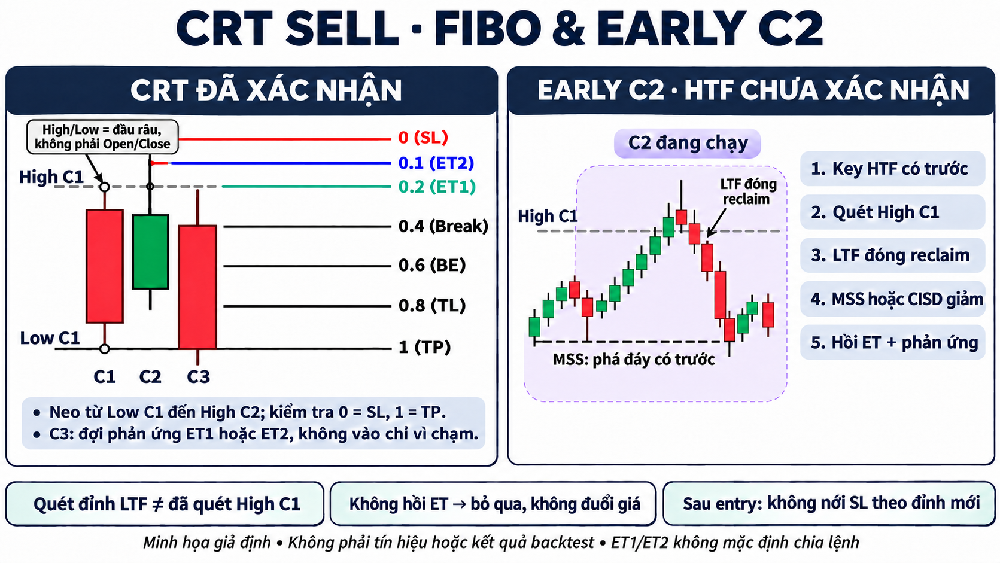
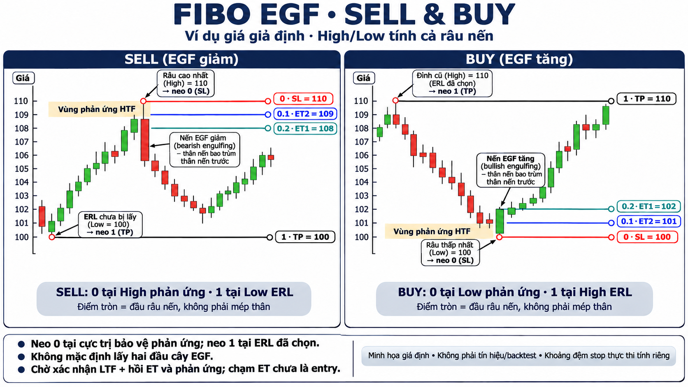
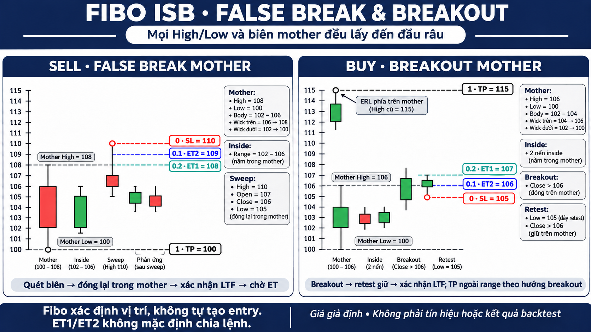

# Quy ước fibo cá nhân

Cập nhật theo xác nhận của người dùng ngày 17/11/2026 và hai ảnh mẫu. Đây là quy ước đánh dấu chart, chưa phải yêu cầu thay đổi thuật toán chỉ báo hoặc tự động quản lý lệnh.

| Mức fibo | Nhãn hiện hành | Ý nghĩa / thay đổi |
| --- | --- | --- |
| 0 | SL | Cực trị sweep; trong ví dụ Sell là đỉnh sweep. |
| 0.1 | ET2 | Mức trước đây mang nhãn SL. |
| 0.2 | ET1 | Mức trước đây mang nhãn ET. |
| 0.4 | break | Giữ nhãn theo ảnh mẫu. |
| 0.6 | BE | Giữ nhãn theo ảnh mẫu. |
| 0.8 | TL | Giữ nhãn theo ảnh mẫu. |
| 1 | TP | Đầu bên kia của đoạn fibo đã neo. |

Ảnh mẫu dùng SL đỏ, ET2 xanh dương, ET1 xanh ngọc; các mức còn lại màu đen. Mức 1.618 không bật trong ảnh setting.

Không tiếp tục dùng tên SL cho mức 0.1 hoặc ET cho mức 0.2 trong quy ước mới. ET1/ET2 là hai mức đánh dấu entry; chưa có chỉ dẫn tự động vào cả hai, chia khối lượng hoặc bình quân giá. Các nhãn break/BE/TL không tự trở thành điều kiện bắt buộc dời SL hay trailing. Giữ nguyên nguyên tắc TP toàn bộ, SL hoặc đóng tay; không suy ra chốt một phần từ bảng này.

## Neo cho CRT và hai nhánh thời điểm

CRT Sell: kéo từ **Low C1 (anchor)** đến **High C2 (cực trị sweep)**, kiểm tra trên công cụ rằng High C2 có nhãn 0/SL và Low C1 có nhãn 1/TP. Buy đọc đối xứng. Giá tại mức r được tính từ SL tới TP: `SL + r × (TP − SL)`. Vì vậy với Sell, ET2/0.1 cao hơn ET1/0.2 và gần SL hơn. Không suy ra số lot từ độ rộng hình vẽ.

**High/Low lấy toàn bộ râu nến:** High là đầu râu trên, Low là đầu râu dưới, không phải Open/Close. Quy tắc này áp dụng cho C1, C2, mother, cực trị phản ứng và ERL được chọn. Điểm tròn trong ảnh đánh dấu cực trị nguồn. Nếu nến không có râu ở một phía thì cực trị có thể trùng mép thân; ảnh có râu phải neo đến đầu râu.

- **CRT Confirmed:** C2 HTF đã quét và đóng trong range C1; sang C3 chờ hồi và phản ứng tại một trong hai ET, cùng điều kiện entry LTF đã chọn. Không bắt buộc C3 sẽ hồi đủ hoặc đạt TP.
- **Early C2:** HTF chưa xác nhận. Cần key HTF có trước, thực sự vượt High C1 đối với Sell, LTF đã đóng reclaim, MSS hoặc CISD giảm, rồi hồi ET và phản ứng. Quét một đỉnh LTF chưa vượt High C1 không là sweep của CRT HTF đó. Đây là nhánh riêng cần thống kê riêng, không gọi là CRT Confirmed.
- Trước entry, đỉnh C2 và fibo còn tạm; đỉnh mới yêu cầu đánh giá lại sweep/reclaim/xác nhận. Sau entry, không nới SL theo đỉnh mới. Cực trị chart khác giá stop thực thi nếu có tick buffer/slippage; phải tính tổng rủi ro trước.
- ET1/ET2 không tự là lệnh limit hoặc hai lệnh cộng dồn. Nếu chia entry phải định trước phân bổ tổng rủi ro; ET1 bị xuyên không tự tạo lý do vào ET2.

## Khi giá chạy nhanh

Chưa xác nhận thì chờ; đã xác nhận nhưng không hồi ET thì bỏ qua nhánh ET/Pullback. Lần chạm ET trước xác nhận không trở thành entry hợp lệ hồi tố. Target đã bị lấy trước entry thì ngừng dùng bộ neo cũ. Không kéo lại TP/SL để đuổi giá. Entry market tại close xác nhận phải là nhánh riêng, không trộn kết quả với Pullback. Có cấu trúc mới thì đánh giá một setup mới.

## Áp dụng EGF và ISB

Giữ ý nghĩa 0 = vô hiệu và 1 = mục tiêu, không áp cứng C1/C2 của CRT cho mọi model.

| Kịch bản | Đầu 0 | Đầu 1 |
| --- | --- | --- |
| CRT Sell | High C2 đã sweep | Low C1 |
| EGF phản ứng tại IRL | Cực trị bảo vệ phản ứng, được xác nhận trong kịch bản | ERL còn hiệu lực đã chọn trước |
| ISB false break | Cực trị false break | Biên đối diện mother nếu đường đi còn hợp lệ |
| ISB breakout | Điểm vô hiệu của breakout/retest | Thanh khoản bên ngoài theo hướng breakout |

Không có sweep thì không gọi mức 0 là “đỉnh sweep”. EGF không mặc định lấy High/Low của cây EGF làm hai đầu; ISB breakout không lấy biên mother ngược hướng làm TP. ET nằm ngoài vùng phản ứng không tự tạo thêm lý do giao dịch.

## Phạm vi thực thi

Các mục trên là quy trình cá nhân được lưu ngày 17/11/2026, chưa phải quy tắc được tối ưu bằng dữ liệu thị trường. Pine hiện vẫn chỉ phát tín hiệu từ model HTF đã xác nhận; **chưa phát Early C2, chưa vẽ fibo/ET, chưa tự đặt lệnh hoặc quản lý BE/TL**. Lần cập nhật này chỉ thay chọn context EGF/ISB theo [range và cụm kích hoạt](MODEL-CONTEXT-PRIORITY.md).

