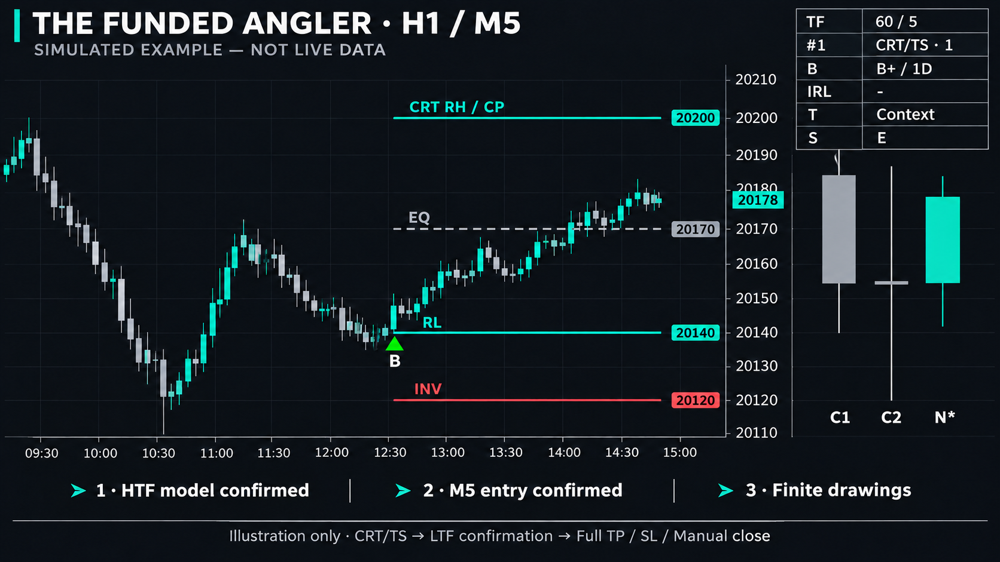

# Setting TFA v6 theo hệ thống cá nhân

Mục tiêu: HTF xác định CRT/TS, Engulfing/Outside hoặc Inside Bar; LTF chỉ tìm entry. Một đích Full TP, SL cấu trúc hoặc đóng tay. Không có chốt từng phần hay BE bắt buộc theo R. Cấu hình dưới đây là điểm bắt đầu để đọc chart và Replay, chưa phải bộ thông số được chứng minh có lợi thế thống kê.

Ảnh được tạo bằng imagegen để hình dung cách đọc: model HTF → tam giác entry LTF → đường có giới hạn và cụm nến bên phải. Đây là minh họa bố cục, không phải ảnh chụp TradingView, dữ liệu thị trường hay xác nhận OHLC/hiệu quả của code. Vị trí chữ, nét đứt và việc gộp nhãn trùng giá trong ảnh mang tính minh họa; giao diện thực vẫn phụ thuộc chart/input.

## Cấu hình khởi đầu

| Nhóm | Setting nên dùng | Lý do |
| --- | --- | --- |
| Cấu trúc | HTF = 60 (H1), hoặc 120 (H2) nếu bạn đọc model trên H2 | Chọn đúng khung dựng kịch bản; không đổi chỉ để tìm thêm tín hiệu. |
| Entry | Chart M5; LTF condition = Auto | Đọc phản ứng sau xác nhận HTF; chuyển M3/M1 khi kế hoạch đã quy định, không dùng để tạo lại model HTF. |
| Bias | Auto D1, persistence 3, alignment bật | Khởi đầu nhất quán với bias cấu trúc của script. Nếu kế hoạch cá nhân khác, chủ động Long/Short và ghi lý do. |
| TS | C1 range, penetration 1 tick | Nhận diện sweep/reclaim của range. Tick chỉ là ngưỡng kỹ thuật, không đo chất lượng setup. |
| Hiệu lực | Invalidation Close; expiry 0 | Giữ model cũ còn hiệu lực. Không nhầm cửa sổ hiển thị 3 nến với thời hạn model. |
| Xác nhận | Pivot HTF/LTF = 2; R:R tối thiểu = 2 | Giữ nguyên trước khi có dữ liệu Replay đủ để điều chỉnh. |
| Thời gian | Context only; QT bật; nền macro và TO tắt | Quan sát macro/QT; chỉ bật gate khi kế hoạch thực sự giới hạn entry vào cửa sổ đó. |
| Hiển thị | Latest marks 1; recent bật; horizon 3; model phụ và C/M tắt | Giữ chart gọn, tránh nhầm xác nhận sơ bộ với entry. |
| Cỡ chữ | Chart Normal; dashboard Small | Chữ chart tăng hai mức, dashboard tăng một mức so với bản cũ. Khi chia đôi màn hình, thử dashboard Normal. |

Bạn không phải chỉnh hết setting mỗi phiên. Thường chỉ cần xác định **HTF**, xem **bias**, chọn **Auto hoặc điều kiện entry đã lên kế hoạch**, nhập mức tay nếu có. Các thông số phục hồi, queue, pivot và hình thức nên giữ ổn định.

## Khi nào dùng điều kiện entry nào?

| Lựa chọn | Hành vi code | Cách dùng phù hợp |
| --- | --- | --- |
| Auto | CRT/TS: C hoặc M; EGF/OUT có hướng: chạm IRL, đóng ra phía ERL, rồi C hoặc M hoặc retest FVG/OB; ISB breakout: retest mother rồi C/M hoặc FVG | Khởi đầu để theo điều kiện riêng của từng model. Neutral không phát entry. |
| CISD / MSS | Chỉ kiểm tra loại xác nhận đã chọn | Dùng khi setup yêu cầu riêng loại đó. CISD là biến thể run-open; MSS dựa pivot đã biết lúc kích hoạt model; riêng EGF lấy lại pivot đã xác nhận tại lần chạm IRL. |
| FVG retest / OB retest | Gap/OB candidate LTF hình thành sau kích hoạt, rồi có retest ở bar sau | Muốn đợi hồi vùng thay vì vào ngay khi close xác nhận C/M. Không tự ép thêm điều kiện IRL/mother của Auto. |
| POC close | Close LTF cắt qua POC nhập tay theo hướng model | Khi điều kiện entry thực sự là POC từ FRVP. Không phải chỉ chạm POC, không tự tính FRVP. |
| Line close | Close cắt qua BL nhập tay | Điều kiện break bằng close. |
| Line touch | Chạm BL trong dung sai, close ở đúng phía hướng model | Điều kiện chạm kèm xác nhận close, không vào giữa nến ngay lần chạm đầu. |
| Line retest | Close break BL, rồi nến sau quay lại chạm và đóng đúng phía | Điều kiện break rồi retest; không dùng cùng nến breakout làm retest. |

Các lựa chọn khác Auto **thay thế điều kiện Auto**, không cộng thêm vào Auto. Tất cả vẫn cần model HTF có hướng, bar LTF đã đóng, SL/CP hợp lệ, R:R đủ, bias/time nếu bật, chưa thấy CP bị lấy và bar tín hiệu không chạm SL tham chiếu. Một tín hiệu cho mỗi model/revision; không lặp mũi tên mỗi lần quay lại vùng.

## Tra nhanh toàn bộ setting

Tên dưới đây khớp tên trong Inputs; di chuột vào biểu tượng trợ giúp để xem giải thích tiếng Việt ngay trong TradingView.

| Setting | Ý nghĩa / cách dùng |
| --- | --- |
| HTF | H1/H2/H4/D1 dựng model; chart phải <= HTF và chia hết độ dài HTF. Chỉ M1/M3/M5 nhỏ hơn HTF phát entry. |
| TS penetration (ticks) | Mức xuyên tối thiểu; không phải khoảng SL hay mức lọc nhiễu đã backtest. |
| Recovery window | 1000 khoảng lịch HTF để khôi phục registry; không phải số hình lịch sử. HIST báo thiếu dữ liệu tải. |
| Active models maximum | 12 model mặc định; đầy thì bỏ model mới, không xóa model cũ còn hiệu lực. |
| Model expiry | 0 không hết hạn do tuổi; >0 hết hạn sau số bar HTF chọn. |
| Invalidation | Close/Wick vượt INV của cấu trúc; không mô phỏng SL thực tế. |
| HTF swing confirmation L/R | 2 bar trái/phải mặc định; ERL chỉ biết sau khi pivot xác nhận. |
| Show mechanical OB candidates | Cho phép OB? khi chọn vùng; đây là candidate cơ học. |
| CRT TS reference | C1 range tự dùng C1; Marked HTF levels dùng mức SSL/BSL bạn nhập. |
| Optional SSL / BSL | Mức tham chiếu TS nhập tay; 0 bỏ trống. Không phải FRVP/POC. |
| Bias TF | Khung bias >= HTF; D1 mặc định. |
| Bias persistence | 3 bar tham chiếu nếu chưa có sự kiện mới, sau đó neutral. |
| Bias | Auto hoặc chủ động Long/Short/Neutral. Auto không có toàn bộ ngữ cảnh FRVP, day high/low và cách đọc cá nhân của bạn. |
| Require bias alignment for E | Bật thì bias phải cùng hướng entry; neutral/ngược hướng không có tam giác. |
| LTF condition | Auto hoặc một điều kiện thay thế trong bảng phía trên. |
| LTF pivot confirmation L/R | Độ trễ xác nhận pivot cho MSS, mặc định 2. |
| FRVP POC (manual, optional) | Nhập POC thực khi dùng POC close. |
| BL (manual, optional) | Giá line cho Line close/touch/retest. |
| Execution SL | 0 dùng INV HTF; nhập giá SL entry nếu kế hoạch dùng mức khác. Không sửa INV của registry. |
| CP override | 0 dùng CP model; nhập đích cá nhân khi cần. CRTH/CRTL có vai trò tùy bias/kịch bản, không cố định thành TP. |
| Minimum planned R:R | Tính tại close nến entry với SL/CP tham chiếu. Không phải R nhận thực tế. |
| Retest tolerance | Dung sai tick cho BL/biên mother, không mở rộng mọi vùng FVG/OB. |
| C / M confirmation marks | Bật: thêm tam giác sơ bộ, chữ B C hoặc S M và một line CISD hoặc MSS từ đúng nến LTF xác nhận; mỗi mức giữ nguyên giá và mốc đầu riêng, kéo hữu hạn theo horizon. Tam giác Tiny, xanh Buy dưới nến/đỏ Sell trên nến; chữ cách tam giác một dòng đệm thay vì hai dòng. Tooltip ghi loại xác nhận; entry cùng nến được ưu tiên và giữ chữ BUY/SELL. Tắt: ẩn dấu và line xác nhận này; không đổi logic entry/alert. Giới hạn latest marks áp dụng dấu; mỗi lượt phản ứng chỉ giữ một loại xác nhận; entry C/M đủ gate có thể thay thế loại sơ bộ trước đó. |
| Time filter for E | Context only không chặn giờ; Web macros/working windows chỉ cho E trong cửa sổ tương ứng web, dùng giờ New York có DST. |
| Macro background | Chỉ tô nền context. |
| QT clock context | Đồng hồ quý intraday; không quyết định bias. |
| Actual TDO / session TO prices | Plot giá mở đúng mốc nếu có dữ liệu; có lịch sử riêng, mặc định tắt. |
| Model HTF candle cluster | C1/C2/C3 của model ưu tiên, không nhất thiết là ba nến mới nhất. |
| Additional live HTF candle | N* live bổ sung khi C3 đã cố định; preview thiếu đầu bucket không hiển thị. |
| Cluster offset / body width | Offset yêu cầu 15 bar / thân 6 bar mặc định. Khi có line, cụm tự lùi tối thiểu để dành khoảng cho chú thích bên phải line theo cỡ chữ. Nếu zoom ngang quá nhỏ, tăng offset hoặc giãn chart để đủ chỗ chữ theo pixel. Râu nến solid mảnh 1 px, đồng màu; độ rộng thân lẻ làm tròn xuống số chẵn để râu đúng tâm. Không đổi OHLC. |
| Model range / ERL / CP | Bật để thấy RH/RL/EQ/INV/CP/ERL của model HTF đã xác nhận. Trên LTF, khi chưa có C/M/E thì bắt đầu từ nến nhận model; có tín hiệu gần nhất thì dùng nến tín hiệu đó. Không cần bật C/M để thấy tổng quan. Nhãn bên phải line; mức trùng giá/cùng neo gộp nhãn. ERL chưa có swing hợp lệ vẫn để trống. |
| Two newer active ranges | Hai model phụ trên HTF, mặc định tắt; không đổi thứ tự registry. |
| Compact panel | Dashboard góc trên phải; kích thước tự theo chữ/nội dung. |
| Signal history: latest marks | 1 dấu mặc định; 0 không vẽ dấu; tối đa 100. Không thay alert. |
| Hide drawings without a recent signal | Ẩn hình quá tuổi; model HTF gần đây được tính là tín hiệu cấu trúc nên cả mức giá lẫn cụm HTF có thể hiện trước C/M/entry trên LTF. Model quá tuổi vẫn có thể còn trong registry; tắt setting này để xem lại mức của model đó. |
| Drawing horizon / recency | 3 nến HTF mặc định; vừa hạn chiều dài vừa hạn tuổi hình khi bật recent. Đường còn được cắt trước cụm HTF. |
| Buy / Sell triangles | B xanh lên dưới low/S đỏ xuống trên high nến LTF xác nhận đủ gate, có khoảng hở và chữ rời ghi loại xác nhận; không phải lệnh tự động. |
| Chart text size | Small/Normal/Large/Huge; Normal mặc định. Áp dụng nhãn, vùng IRL, caption và đồng hồ. |
| Dashboard text size | Small/Normal/Large; Small mặc định. |

## Đọc dashboard và trường hợp không có tam giác

| Dòng | Cách đọc |
| --- | --- |
| TF | HTF / chart TF, ví dụ 60 / 5. |
| #1 | Model ưu tiên và số model còn trong registry. Model cũ còn hiệu lực đứng trước. |
| B | B+ Long, B− Short, B0 Neutral / khung tham chiếu. |
| IRL | FVG hoặc OB? đang được vẽ; dấu − có thể do chưa có vùng hoặc hình đang bị ẩn. |
| T | Macro hiện hành và quý ngày/phiên nếu bật QT. |
| S | WAIT chưa có model; COMP chưa có hướng; LTF chờ entry; CP − thiếu đích; E đã phát tín hiệu; CP? giá LTF đã chạm CP chờ xét HTF; HIST thiếu lịch sử. Dấu + báo có model mới bị bỏ vì queue đầy. |

Nếu chưa có tín hiệu, kiểm tra lần lượt: **HIST và chart TF → model có hướng → CP/SL → bias → entry condition và mức tay → R:R → giờ → đã phát E/CP bị lấy → giới hạn hình gần nhất**. Tăng số dấu không làm điều kiện dễ hơn; tắt filter cũng không tự nâng chất lượng tín hiệu.

## Cách kiểm chứng trước khi đổi thông số

1. Trên H1/H2, đối chiếu C1/C2/C3, TS, INV, IRL/ERL với cách tự vẽ.
2. Chuyển M5 cùng symbol/session; kiểm tra timestamp và OHLC trong tooltip cụm HTF, nhất là N*.
3. Replay cả ba nhóm model; ghi lý do có/không có B/S, giữ cả setup không đi tới đích.
4. Mỗi lần chỉ đổi một điều kiện, so sánh cùng tập dữ liệu và một giai đoạn khác. Tách tính đúng logic khỏi hiệu quả trade thực tế.
5. Khi vừa sửa code: xóa instance cũ/thêm lại, ghim cùng scale với symbol; tạo lại alert nếu đang sử dụng.

Chữ dùng các mức kích thước Pine, không phải số pixel cố định. Dashboard theo cơ chế table tự co theo chữ/nội dung: [TradingView tables](https://www.tradingview.com/pine-script-docs/visuals/tables/). Tooltip là trợ giúp Inputs: [TradingView inputs](https://www.tradingview.com/pine-script-docs/concepts/inputs/).

## Đường xanh/vàng và bố trí chú thích

- Hai plot bối cảnh chạy từ giá mở: **TDO actual open** màu xanh aqua là giá mở ngày; **Session TO actual open** màu vàng/cam là giá mở phiên theo mốc thời gian của hệ thống. Chúng thuộc `Actual TDO / session TO prices`, không thuộc C/M. Tắt setting này nếu không dùng các mốc đó. Các đường có nhãn CP/ERL/RH/RL là nhóm reference cấu trúc khác, không phân biệt chỉ bằng màu.
- CISD line dùng delivery level đã bị close vượt qua lúc C được xác nhận. MSS line dùng pivot đã biết khi kích hoạt model; riêng EGF lấy lại pivot đã xác nhận tại lần chạm IRL. Giá được chụp tại bar xác nhận, không chạy theo delivery/pivot thay đổi sau đó. Mỗi line khởi đầu từ bar xác nhận của chính nó, không kéo ngược về bar nguồn đối nghịch/pivot và không kéo vô hạn.
- Mức HTF trên LTF không còn phải chờ C/M hoặc entry E: model HTF mới xác nhận/resolve trong cửa sổ gần nhất có thể hiện tổng quan ngay tại nến LTF nhận model. Khi có C/M hoặc E, dùng nến tín hiệu gần nhất làm neo thay thế. Bật/tắt C/M chỉ thêm/bớt dấu sơ bộ và line CISD/MSS; không tắt nhóm RH/RL/EQ/INV/CP/ERL. Không thay thuật toán phát E hoặc alert.
- Nhãn line nằm bên phải; mức trùng giá và cùng neo gộp nhãn. Các nhãn gần nhau được xếp cách nhau theo dải giá đang nhìn và cỡ chữ; đường dẫn chấm chỉ lại mức thật nếu chữ bị dịch. **Đường giá không bị dịch để né chữ.** IRL không viết chữ trong box nữa, dùng nhãn bên ngoài cùng hệ thống sắp xếp.
- Nhãn chữ có nền trong suốt, không che nét phía sau; captions HTF được đặt dưới đáy cụm, tính cả live khi bật. Các biện pháp này giảm đè chữ/line trong bố cục thông thường. Pine không cung cấp bounding box chữ hay thang giá pixel của chart, nên chưa thể bảo đảm tuyệt đối ở mọi mức zoom, cỡ cửa sổ, log scale hoặc khi kéo scale bằng tay. Hình thực tế của bản này vẫn cần đối chiếu trên TradingView.

Nhãn dùng ASCII: entry `BUY C`/`SELL M`, xác nhận sơ bộ `B C`/`S M`. Đã khôi phục chữ xác nhận và rút đệm về một dòng để gần tam giác hơn. Mọi tam giác giữ Tiny, Buy xanh (lime), Sell đỏ. Nguồn giữ UTF-8 để tooltip tiếng Việt có đầy đủ dấu. Chưa xác nhận lỗi font trên chart thực tế; kiểm tra mã hóa không thấy ký tự thay thế hoặc ký tự zero-width.

## EGF: pha hồi IRL và pha đi tới ERL

EGF/OUT có hướng (không phải nhánh resolve bằng TS) chỉ tìm entry cùng hướng kịch bản sau phản ứng IRL:

| Kịch bản | Điều kiện trước xác nhận/entry | Hướng và đích |
| --- | --- | --- |
| EGF tăng | Có bar LTF thật sự chạm vùng IRL được chọn, sau đó close trên biên trên IRL; CP cao hơn giá và vùng IRL | Buy tới ERL+/CP |
| EGF giảm | Có bar LTF thật sự chạm IRL, sau đó close dưới biên dưới IRL; CP thấp hơn giá và vùng IRL | Sell tới ERL-/CP |

Giá mới đi về phía IRL chưa phải entry. Giá đã ở xa IRL nhưng chưa quan sát được lần chạm sau kích hoạt model cũng không được suy ra là đã phản ứng. Nến chạm và đóng trở lại đúng phía trong cùng bar có thể hợp lệ; đây là dữ liệu OHLC đóng nến, không xác định thứ tự tick nội bộ. Không ép đảo hướng chỉ vì giá đang hồi hoặc bias ngược; bias vẫn là gate riêng. Thiếu IRL hoặc CP hợp lệ thì chờ.

Nếu đã chạm rồi đóng vượt biên xa của vùng (Buy: dưới đáy IRL; Sell: trên đỉnh IRL), khóa lượt phản ứng IRL đó trên LTF. Chỉ reset khi vùng được chọn/model thay đổi. Đây là khóa entry LTF, không tự hủy registry HTF trước khi HTF đóng. Nếu ERL/CP đã bị lấy, không phát xác nhận mới để đuổi giá.

MSS lấy lại pivot LTF đã biết tại lần chạm IRL. FVG/OB LTF cũ trước pha chạm được bỏ; FVG mới cần ba nến từ pha chạm trở đi và retest ở bar sau. Các mode CISD/MSS/FVG/OB/POC/Line chọn riêng vẫn phải qua điều kiện phản ứng IRL của EGF; chúng không cho phép bỏ qua pha này. Một E cho model/revision vẫn giữ nguyên, không tự tạo thêm lệnh khi đổi vùng. Panel S: IRL WAIT = chưa chạm; IRL = chờ đóng ra đúng phía; IRL X = vùng bị đóng xuyên trên LTF.

CISD/MSS chung vai trò xác nhận trong quy trình, nhưng không đổi công thức thành cùng một phép đo: C là close vượt run-open đối hướng; M là close vượt pivot đã xác nhận. Chỉ một xác nhận sơ bộ cho mỗi lượt; nếu cả hai cùng bar thì ưu tiên C, trừ mode MSS. Nếu entry C/M đủ gate xuất hiện sau xác nhận sơ bộ, line hiện hành chuyển sang loại của entry và xóa loại còn lại. Confirmation chưa qua gate bias/R:R/time không phải lệnh thật. Không thêm ngưỡng displacement chưa được đặc tả/backtest.
