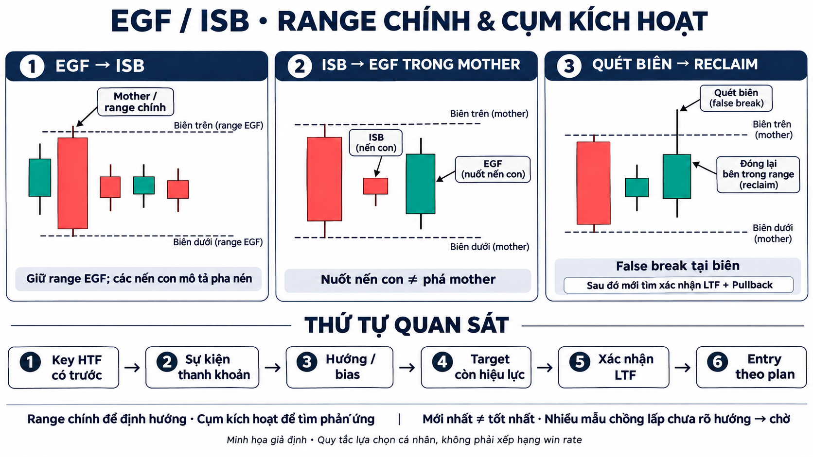

# Range chính và cụm kích hoạt EGF/ISB

> Lưu ý 21/11/2026: phần mô tả nhiều model là lịch sử trước CRT V1. Chỉ báo hiện chỉ có CRT, entry trong C3; ưu tiên [đặc tả hiện hành](CRT-V1-SPEC.md) và [setting CRT V1](INDICATOR-SETTINGS.md). Web hiện đã đồng bộ CRT-only; các mẫu cũ chỉ giữ trong lịch sử.

Ngày 17/11/2026. Không có thứ tự cố định EGF > ISB hoặc ngược lại; mẫu mới nhất không tự có xác suất tốt nhất. Quy trình dưới đây là đặc tả cá nhân, chưa là bảng xếp hạng win rate.

## Hai lớp đọc chart

**Range chính** giữ bối cảnh HTF: biên, thanh khoản, mục tiêu, mức vô hiệu. **Cụm kích hoạt** là mẫu phản ứng tại vị trí đang chờ để xuống LTF xác nhận. Một mẫu mới nằm trong range không tự thay thế range chính; range cũ còn hiệu lực cũng không tự là lựa chọn entry tốt nhất lúc này.

Thứ tự quan sát: key HTF đã biết trước → sự kiện quét/reclaim, phản ứng rời vùng hoặc breakout giữ được → hướng/bias và ngoại lệ được định nghĩa → target chưa bị lấy, đường đi còn hợp lý → xác nhận LTF → entry theo plan. Số lượng mẫu chồng lấp không phải số lần xác nhận độc lập. Không rõ hướng thì chờ.

| Chuỗi | Cách đọc |
| --- | --- |
| EGF → nhiều ISB trong EGF | Giữ range EGF; các nến trong mother là pha nén, không chuyển mother theo từng cặp kề nhau. |
| ISB → EGF trong mother lớn | EGF nuốt nến con không tự là phá mother. |
| ISB → xuyên biên mother rồi đóng trong | Xét false break/TS; chỉ gọi CRT nếu đủ quy tắc CRT riêng. |
| ISB → đóng vượt mother rồi retest giữ | Xét breakout tiếp diễn; mục tiêu ngoài range theo hướng breakout. |
| EGF/ISB đối nghịch, chưa giải quyết range | Giữ bối cảnh và chờ sự kiện; không buộc chọn hướng theo cây cuối. |

Ví dụ bias Sell: EGF giữa range chỉ là bối cảnh; cụm mới tại bearish OB HTF/iBSL có sự kiện quét-reclaim và xác nhận LTF mới là vị trí kích hoạt đáng theo dõi. Cần đánh giá các mức thực tế, không đổi hai đầu fibo liên tục để ET khớp giá.

## Phần được triển khai trong chỉ báo

Cụm chính hiển thị vẫn là model cũ nhất còn hiệu lực theo FIFO, phù hợp quan sát range. CRT giữ chọn model đủ điều kiện theo quy tắc hiện hành. Chỉ hai kênh EGF/ISB thay chọn context trong cùng nhóm:

1. Model có hướng theo bias, target tồn tại và có reference phù hợp (EGF) hoặc đã resolve (ISB), được ưu tiên hơn model chưa sẵn sàng.
2. Trong số đó, model có sự kiện vị trí đã được xác nhận trên HTF được ưu tiên hơn model chỉ đang chờ.
3. Nếu cùng có sự kiện, ưu tiên sự kiện gần nhất; cùng thời điểm giữ thứ tự cũ. Nếu chỉ đều đang chờ, giữ FIFO. Nếu không model nào đủ điều kiện thì giữ fallback để báo nguyên nhân, không tự cho phép entry.

Các mức 0/1/2 trong helper là **trạng thái sẵn sàng**, không phải điểm chất lượng/probability. Sự kiện EGF là HTF sau khi model được xác nhận giao FVG/OB và close giữ phía vùng, hoặc quét-reclaim swing nội bộ. ISB false break dùng close resolve; ISB breakout cần HTF sau resolve retest boundary và close giữ phía breakout. Đứng lì trong vùng không được cập nhật “sự kiện mới” mỗi nến; phải rời rồi trở lại. Thay hướng, reference hoặc loại reference xóa sự kiện cũ.

LTF vẫn phải tự quan sát vị trí và thỏa CISD/MSS/FVG/OB/Pullback theo mode; một sự kiện HTF không tự phát tam giác. Vòng đời TG/INV/TO/AMB, bias guard, close-bar, time, shared wave gate và limit lịch sử giữ nguyên. Đổi context không vượt qua wave gate. Cụm chính có thể khác model phát tín hiệu; tooltip giữ provenance của tín hiệu.

## Giới hạn

Code chưa suy luận toàn bộ chuỗi cha/con giữa các loại model hoặc đọc key/FRVP do bạn vẽ thủ công. Mẫu đối nghịch vẫn do ba kênh độc lập và gate bias xử lý, không có thuật toán chứng minh mẫu nào “uy tín nhất”. Sự kiện HTF mới xác nhận có thể được ưu tiên muộn hơn phản ứng intrabar; không dùng thông tin đóng nến tương lai. Không thêm phần tử request, tổng tuple giữ 127. Early C2 và fibo ET chỉ là đặc tả, chưa là nhánh phát tín hiệu.

`node tests/model-context-priority.cjs` thực thi thân helper thực tế: đủ/thiếu reference, bias/target, sự kiện mới, FIFO khi hòa, không ưu tiên chỉ vì mẫu mới, chạm khác quét, thay reference, thời điểm xác nhận, unresolved/false-break/breakout ISB và không thay range chính. Đây là fixture synthetic, không mô phỏng request.security/rollback và không phải Replay/backtest.

Ngày 17/11/2026: source cuối được gửi nguyên bản vào Pine Editor tạm và biên dịch thành công, không có lỗi; còn cảnh báo shadow biến cục bộ. Các test contract, CRT counter-bias, EGF internal references, OB timeframe roles, HTF cluster, signal density và day-trading workflow đều qua. Chưa nghiệm thu thay đổi chọn context trên chart/Replay thị trường.

## Nguồn tham khảo

- [TradingView: Engulfing và giới hạn hình thái](https://www.tradingview.com/support/solutions/43000583769-engulfing-bearish/).
- [Nial Fuller: Inside Bar theo trend và key level](https://www.learntotradethemarket.com/forex-trading-strategies/inside-bar-forex-strateg).
- [PriceAction.com: nhiều inside bar trong cùng mother](https://priceaction.com/price-action-university/strategies/inside-bar/).
- [TradingView: dữ liệu HTF chưa xác nhận và repaint](https://www.tradingview.com/pine-script-docs/concepts/repainting/).

Các quy tắc chọn context và fibo ET là quyết định riêng của dự án, không được suy thành kết luận hiệu suất từ các nguồn trên.

